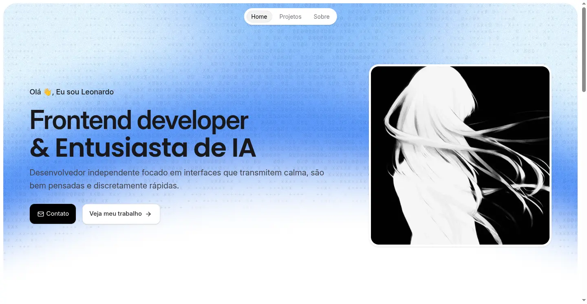

# Leonardo Lyrio | Frontend Developer Portfolio



## 🌐 [Visite o Site](https://leonardolyrio.vercel.app)

Este é o meu portfólio profissional, desenvolvido para apresentar meus projetos e habilidades em desenvolvimento frontend. O objetivo principal foi criar uma interface moderna, responsiva e com foco em performance.

---

## 🛠 Tech Stack

- **Frontend**: React + Vite
- **Estilização**: Tailwind CSS
- **Animações**: Framer Motion
- **Smooth Scroll**: Lenis
- **Linguagem**: TypeScript

---

## 📝 Implementações Técnicas

O projeto utiliza algumas práticas de desenvolvimento para melhorar a entrega final:

- **Otimização de Carregamento**: Uso de `React.lazy` e `Suspense` para carregar as páginas apenas quando necessário.
- **SEO Básico**: Configuração de meta-tags e Open Graph para melhor indexação e compartilhamento.
- **UX & Interação**: Implementação de scroll suave com Lenis e animações de entrada com Framer Motion.
- **Tipagem**: Uso de TypeScript para garantir a consistência dos dados no código.

---

## 💻 Como rodar o projeto localmente

### Pré-requisitos
- Node.js instalado
- npm

### Passos
1. Clone o repositório:
   ```bash
   git clone https://github.com/leonardolyrio/leonardolyrio-portfolio.git
   ```
2. Entre na pasta:
   ```bash
   cd leonardolyrio-portfolio
   ```
3. Instale as dependências:
   ```bash
   npm install
   ```
4. Inicie o servidor:
   ```bash
   npm run dev
   ```

---

Desenvolvido por [Leonardo Lyrio](https://github.com/leonardolyrio)
